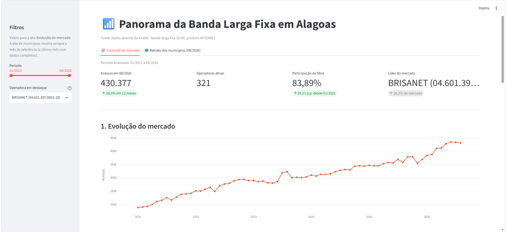
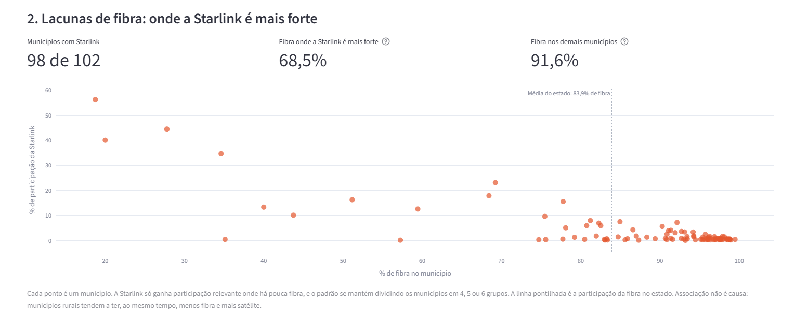
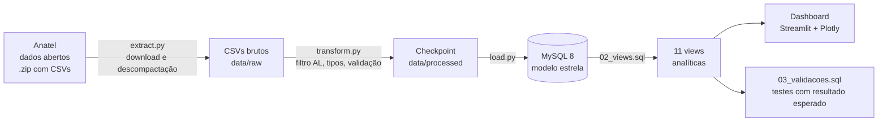
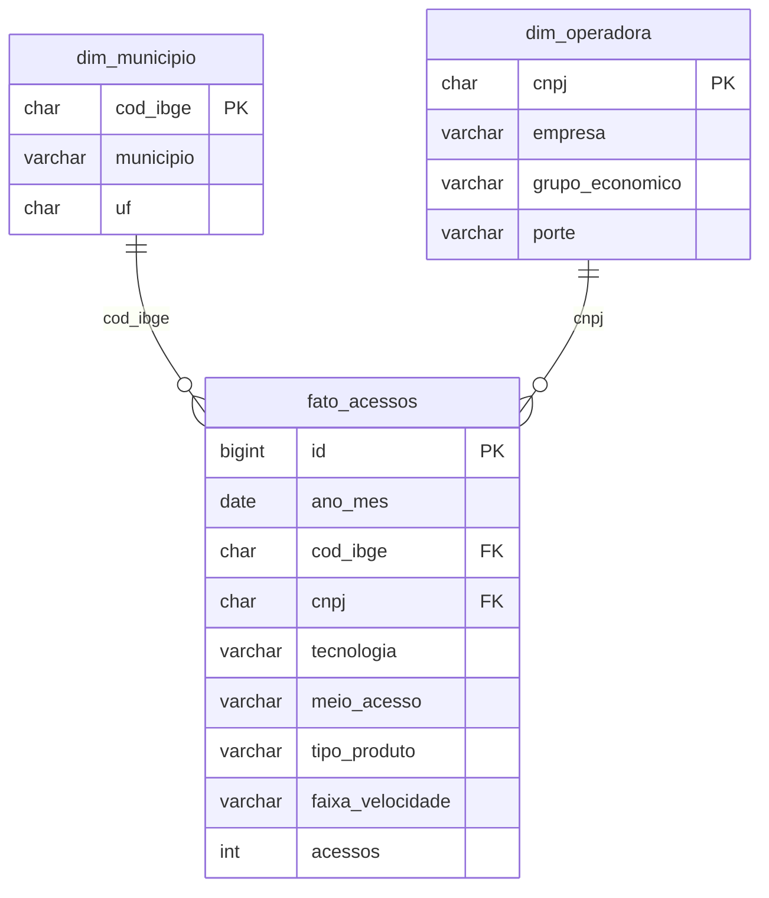

# Panorama da Banda Larga Fixa em Alagoas

Pipeline de dados de ponta a ponta com os dados abertos da Anatel: extração e tratamento em Python, modelo em MySQL, uma camada de views SQL validadas e um dashboard em Streamlit para responder **como está e para onde vai o mercado de internet fixa de Alagoas**.



## Principais achados

Retrato de **ago/2026**, o último mês com dados completos (o motivo está em [Qualidade e validação](#qualidade-e-validação)).

- **O mercado cresce rápido:** 430.377 acessos de internet fixa em ago/2026, **20,47% a mais** que em ago/2025, distribuídos entre 321 operadoras ativas.
- **A fibra virou o padrão:** a participação da fibra passou de **24,68%** em jan/2021 para **83,89%** em ago/2026.
- **Liderança regional e mercado pulverizado:** a Brisanet lidera com 26,25% dos acessos, seguida pela Claro (19,49%). O restante está dividido entre centenas de operadoras, a maioria pequenos provedores.
- **Maceió concentra metade do estado:** são 221.538 acessos (51,48% do total). Mesmo com 137 operadoras, o mercado da capital é concentrado (HHI de 2.622). O município mais competitivo é Arapiraca.
- **A Starlink ocupa as lacunas da fibra:** ela está em 98 dos 102 municípios. Nos 25 municípios onde é mais forte, tem em média 14,62% do mercado, e a fibra fica em 68,54%, contra cerca de 91% nos demais. O padrão se mantém dividindo os municípios em 4, 5 ou 6 grupos: é uma relação de limiar, concentrada nos lugares com pouca fibra.
- **O crescimento acontece onde a fibra já domina:** nenhum dos 10 municípios que mais cresceram em 12 meses está entre as lacunas de fibra.

> Os números descrevem associações nos dados reportados, não causas. Veja as [limitações](#limitações).



## Perguntas de negócio

| Pergunta | Onde é respondida |
| --- | --- |
| O mercado está crescendo? Em que ritmo? | `vw_evolucao_mensal` |
| Quem lidera e como o ranking muda mês a mês? | `vw_market_share` |
| Quanto do mercado já é fibra? | `vw_tecnologia` |
| Como cada operadora evoluiu em relação ao seu registro anterior? | `vw_operadora_destaque` |
| Quanto do mercado está com prestadoras de pequeno e grande porte? | `vw_porte_mensal` |
| Quem lidera o mercado corporativo (linha dedicada)? | `vw_linha_dedicada` |
| Quão concentrado é o mercado de cada município? | `vw_municipio_resumo` |
| Onde a internet via satélite é mais forte, há menos fibra? | `vw_starlink_municipio` |
| Onde o mercado mais cresceu nos últimos 12 meses? | `vw_crescimento_municipio` |
| Quais operadoras reportam de forma regular, intermitente ou pararam? | `vw_qualidade_reporte` |

## Arquitetura



O pipeline é **idempotente**: rodar de novo recria as tabelas e as views e chega ao mesmo resultado. O download e a extração são pulados quando os arquivos já existem, e o resultado do tratamento fica salvo em um checkpoint para não reprocessar os CSVs a cada execução.

## Stack

| Camada | Ferramentas |
| --- | --- |
| Extração e tratamento | Python 3.14, pandas, requests |
| Banco de dados | MySQL 8, SQLAlchemy, PyMySQL |
| Análise | SQL (CTEs, funções de janela, agregação condicional) |
| Visualização | Streamlit, Plotly |
| Exploração | Jupyter |

Também existe uma versão do dashboard em Power BI, que não está no repositório.

## Como rodar

### Pré-requisitos

- Python 3.11 ou mais recente (testado com 3.14.7)
- MySQL 8
- Git
- Cerca de 10 GB livres em disco: o arquivo da Anatel tem cerca de 1 GB compactado e mais de 8 GB descompactado (todo o Brasil)

### Passo a passo

Os comandos abaixo são para o PowerShell (Windows). No Linux e no macOS, a ativação do ambiente é `source .venv/bin/activate` e a cópia do `.env` é `cp`.

```powershell
# 1. Clonar o repositório
git clone https://github.com/Gabriel-1812/panorama-banda-larga-al.git
cd panorama-banda-larga-al

# 2. Criar e ativar o ambiente virtual
python -m venv .venv
.venv\Scripts\Activate.ps1

# 3. Instalar as dependências
pip install -r requirements.txt
```

**4. Criar o banco.** Rode o `sql/00_criar_banco.sql` uma única vez, com um usuário que possa criar bancos, no seu cliente MySQL (Navicat, DBeaver, Workbench) ou pelo terminal:

```powershell
mysql -u root -p -e "source sql/00_criar_banco.sql"
```

**5. Configurar a conexão.** Copie o modelo e edite o `.env`:

```powershell
Copy-Item .env.example .env
notepad .env
```

Preencha o seu usuário e a sua senha do MySQL e confira o `DB_NAME`: ele precisa ser o nome do banco criado no passo 4 (`banda_larga_al`, se você não mudou o script). O pipeline apaga e recria as tabelas do banco indicado ali, então um `DB_NAME` errado sobrescreve outro banco. Salve o arquivo e confira:

```powershell
Select-String "DB_NAME" .env
```

**6. Rodar o pipeline.** Na primeira vez ele baixa e processa todos os arquivos da Anatel (cerca de 3 minutos numa conexão rápida):

```powershell
python -m src.pipeline             # reaproveita o tratamento salvo, se existir
python -m src.pipeline --refazer   # reprocessa os CSVs do zero
```

**7. Abrir o dashboard:**

```powershell
streamlit run app/app.py
```

**8. (Opcional) Conferir os resultados.** Roda todos os testes do `sql/03_validacoes.sql` e salva um relatório em `data/`, com o resultado esperado e o obtido lado a lado:

```powershell
python -m src.validar
```

## Estrutura de pastas

```
panorama-banda-larga-al/
├── app/app.py                 # dashboard Streamlit
├── data/                      # dados baixados e processados (fora do git)
├── docs/
│   ├── dicionario_dados.md    # colunas da base da Anatel e cuidados
│   └── img/                   # prints do README
├── notebooks/01exploracao.ipynb  # exploração inicial dos CSVs
├── sql/
│   ├── 00_criar_banco.sql     # criação do banco (uma vez)
│   ├── 01_schema.sql          # tabelas do modelo estrela
│   ├── 02_views.sql           # camada analítica (11 views)
│   └── 03_validacoes.sql      # testes com resultado esperado
├── src/
│   ├── db.py                  # conexão com o MySQL (lê o .env)
│   ├── extract.py             # download e extração do .zip
│   ├── transform.py           # leitura, limpeza e montagem das tabelas
│   ├── load.py                # criação das tabelas, carga e views
│   ├── pipeline.py            # orquestra as três etapas
│   └── validar.py             # roda as validações e gera o relatório
├── .env.example               # modelo das variáveis de conexão
└── requirements.txt           # dependências com versões fixas
```

## Modelo de dados

Um esquema estrela com uma tabela fato e duas dimensões:



**Decisões principais:**

- **CNPJ e código IBGE como texto:** guardados como `CHAR`, para não perder os zeros à esquerda.
- **`ano_mes` como data** (sempre o dia 1 do mês): permite usar funções de data, como "12 meses atrás", em vez de manipular texto.
- **Chaves estrangeiras e índices:** a fato só aceita municípios e operadoras que existem nas dimensões, e os índices cobrem as consultas por mês, operadora e município.
- **Acessos são um estoque mensal:** representam os clientes ativos no mês, então nunca são somados entre meses diferentes.
- **Recorte a partir de 2021:** antes disso a Anatel usava outra estrutura de arquivo (13 colunas em vez de 16) e outra metodologia.

O detalhe de cada coluna está no [dicionário de dados](docs/dicionario_dados.md).

## Camada analítica

As análises ficam em views SQL, para que o dashboard só leia resultados prontos. Todas seguem as mesmas regras:

- as análises de mercado consideram só o produto INTERNET;
- os acessos nunca são somados entre meses;
- nenhuma data fica fixa no código;
- os percentuais vão de 0 a 100, com 2 casas decimais.

| View | Pergunta | Grão |
| --- | --- | --- |
| `vw_evolucao_mensal` | O mercado está crescendo? | mês |
| `vw_market_share` | Quem lidera e como o ranking muda? | mês × operadora |
| `vw_tecnologia` | Quanto do mercado é fibra? | mês × meio de acesso |
| `vw_operadora_destaque` | Como cada operadora evoluiu desde o registro anterior? | mês × operadora |
| `vw_porte_mensal` | Quanto está com pequeno e grande porte? | mês × porte |
| `vw_linha_dedicada` | Quem lidera o mercado corporativo? | mês × operadora |
| `vw_mes_referencia` | Qual é o último mês com dados completos? | uma linha |
| `vw_municipio_resumo` | Como está a concorrência em cada município? | município |
| `vw_starlink_municipio` | Onde o satélite é forte, há menos fibra? | município |
| `vw_crescimento_municipio` | Onde o mercado mais cresceu em 12 meses? | município |
| `vw_qualidade_reporte` | Quem reporta de forma regular, intermitente ou parou? | operadora |

Algumas técnicas usadas: funções de janela (`LAG`, `RANK`, `ROW_NUMBER`, `SUM OVER`, `NTILE`), agregação condicional para colocar dois meses lado a lado, e o índice HHI (soma dos quadrados das participações) para medir concentração. O HHI vai de 0 a 10.000, e `10.000 ÷ HHI` dá o número de "concorrentes equivalentes".

## Qualidade e validação

O arquivo `sql/03_validacoes.sql` reúne os testes de cada view. Cada teste tem o resultado esperado escrito ao lado, então qualquer mudança no código que altere um número aparece na hora. Os principais tipos de teste:

- **Reconciliação:** o total de cada view bate com o total do estado no mesmo mês (por exemplo, a soma dos 102 municípios dá os mesmos 430.377 acessos da evolução mensal).
- **Prova dos 100%:** as participações de cada mês somam 100%, com diferença apenas de arredondamento.
- **Integridade:** nenhuma linha da fato sem município ou sem operadora, e nenhum acesso negativo.
- **Casos conhecidos:** uma operadora estável (a Claro) aparece sem buracos de reporte, e um município com uma única operadora teria HHI de 10.000.

### O mês de referência

O mês mais recente da base costuma vir incompleto, porque parte das operadoras reporta com atraso. Em set/2026, por exemplo, ainda faltavam cerca de 20 operadoras, e o total parecia uma queda que não existiu. Isso se confirmou na prática: entre dois downloads feitos com duas semanas de diferença, a Anatel acrescentou cerca de 20 mil acessos a set/2026, enquanto ago/2026 mudou só 12 acessos.

Por isso a view `vw_mes_referencia` escolhe o último mês em que o número de operadoras que reportaram é pelo menos **95% da média dos 3 meses anteriores**. Com a base atual, o mês escolhido é ago/2026. Os retratos do dashboard (municípios, Starlink, crescimento) usam esse mês automaticamente, e a regra se ajusta sozinha quando a Anatel publica dados novos.

### Qualidade do reporte

Das 535 operadoras com algum registro de internet até ago/2026, 184 reportam todos os meses, 137 têm meses faltando e 214 deixaram de aparecer. Esse último grupo mistura empresas que encerraram as atividades, foram adquiridas ou mudaram de CNPJ, então não equivale a subnotificação.

## Limitações

- **Dados reportados:** os acessos são os que as operadoras informam à Anatel. Há reporte intermitente e subnotificação, principalmente entre pequenos provedores.
- **Mês preliminar e revisões:** o último mês publicado costuma estar incompleto, por isso as análises usam o mês de referência. Além disso, a Anatel revisa meses passados quando operadoras reportam com atraso, então um novo download pode mudar levemente os números históricos.
- **Porte atual:** a classificação de porte guarda só a situação mais recente de cada operadora, então os meses antigos usam o porte de hoje. "Pequeno porte" é a classificação regulatória da Anatel (menos de 5% do mercado nacional) e inclui operadoras grandes no estado, como a Brisanet.
- **Uma empresa, vários CNPJs:** as análises são por CNPJ. Empresas como a Claro aparecem divididas, e a soma do grupo é um pouco maior que a de cada CNPJ.
- **Crescimento percentual:** crescimentos acima de 100% em 12 meses podem vir de operadoras que passaram a reportar, e não só de clientes novos. Os rankings de crescimento usam um corte mínimo de 500 acessos para não destacar municípios muito pequenos.
- **Associação não é causa:** a relação entre Starlink e falta de fibra mostra onde as duas coisas acontecem juntas, não que uma provoque a outra.

## Próximos passos

- Guardar o porte de cada operadora em cada mês, e não só o atual.
- Agendar a atualização automática quando a Anatel publicar dados novos.
- Criar uma view base por município, reaproveitada pelas views de concorrência e de Starlink.
- Publicar o dashboard on-line.

## Fonte e autor

**Dados:** [Anatel, dados abertos de acessos de banda larga fixa](https://www.anatel.gov.br/dadosabertos/paineis_de_dados/acessos/acessos_banda_larga_fixa.zip), recorte de Alagoas de jan/2021 a set/2026, baixados em 16/11/2026.

**Autor:** Gabriel Frederico de Araujo · [LinkedIn](https://www.linkedin.com/in/gabriel-frederico-de-araujo-26053a385)